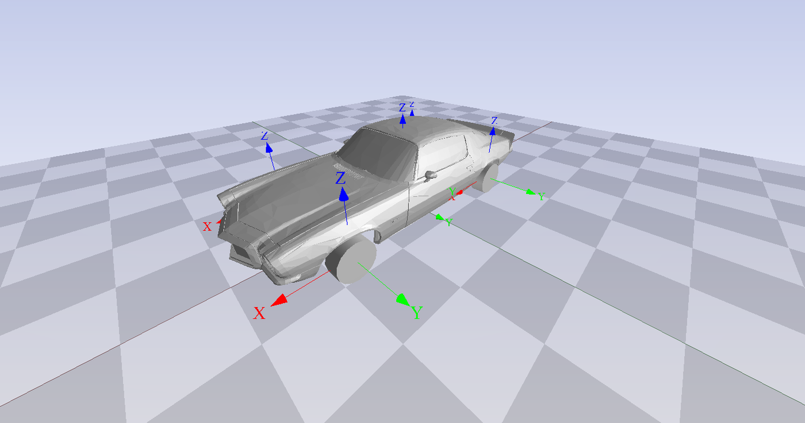
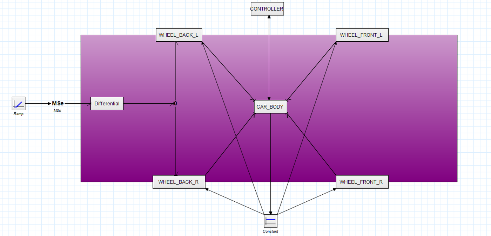
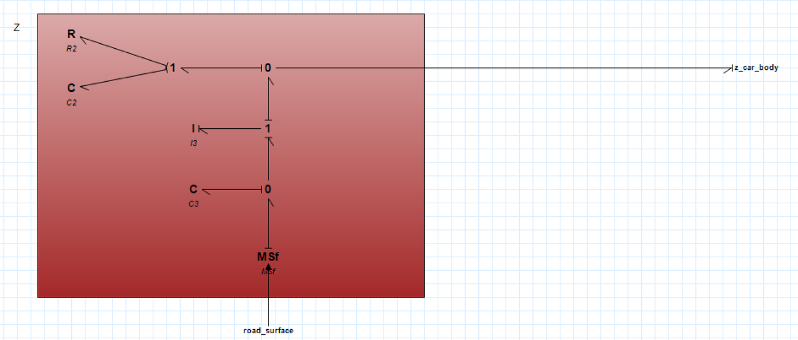
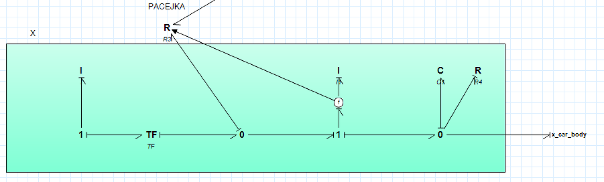
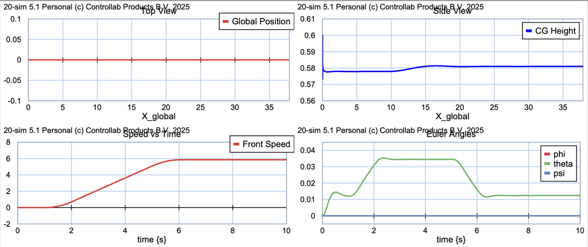
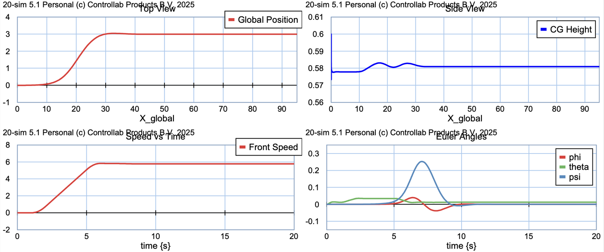
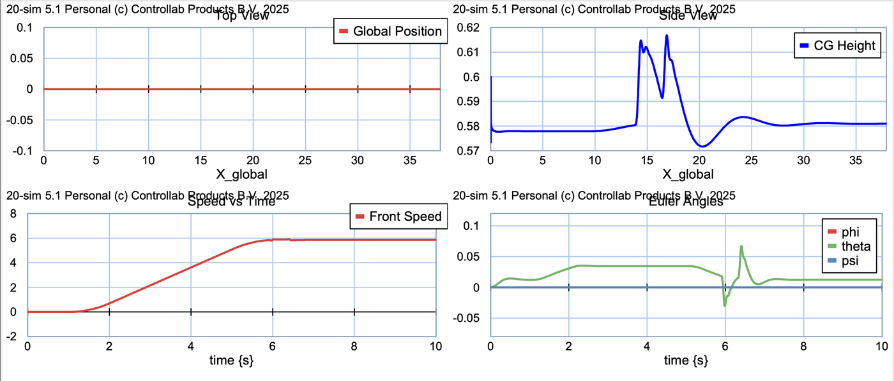

# 6-DOF Vehicle Dynamics with Bond Graphs (20-sim)

A full **6-degree-of-freedom vehicle model** built from scratch with the **Bond Graph** methodology in 20-sim. It couples longitudinal, lateral and vertical dynamics with nonlinear **Pacejka tires**, independent suspensions, an open differential and a **Pure Pursuit** path-following controller. A 3D animation shows the results.

> Project for **Modelling and Simulation of Mechatronic Systems** (2026)
> by **Tommaso Magelli** and Giorgio Giaretta.
> Full report: [`docs/MSMS_Report_Magelli_Giaretta.pdf`](docs/MSMS_Report_Magelli_Giaretta.pdf)



## Why 6-DOF instead of a bicycle model

A planar bicycle model tracks only v<sub>x</sub>, v<sub>y</sub> and yaw rate, so it cannot see **load transfer**. Under acceleration, braking or cornering, the chassis pitches and rolls and the normal load F<sub>z</sub> on each tire changes. Tire grip depends nonlinearly on F<sub>z</sub>, so the 3D behaviour is what decides whether a tire saturates. This model tracks all three translations and all three rotations: roll, pitch and yaw.

## Model architecture



| Block | What it models |
|---|---|
| **Car body** | Sprung mass as a 6-DOF rigid body: Newton-Euler equations with Coriolis terms, rotation of the steered wheel forces into the body frame, rigid-body velocity field back to each hub, and Z-Y-X Euler kinematics for the global trajectory |
| **Wheels (×4)** | Three decoupled bond graphs per wheel. **Z** covers tire radial stiffness, unsprung mass and the suspension spring and damper. **X** covers wheel inertia, the rolling-radius transformer and a Pacejka R-element on the slip velocity. **Y** covers lateral slip and cornering force. X and Y also include bushing compliance |
| **Pacejka tire** | Magic Formula `D·sin(C·atan(Bx − E(Bx − atan(Bx))))` for longitudinal slip *s* and slip angle α, with cosine loss factors for combined slip. The forces scale with the **dynamic** normal load F<sub>z</sub> from the vertical submodel. An ε-floor in the denominators removes the zero-speed singularity |
| **Differential** | TF element for the final-drive ratio followed by a 0-junction, which enforces an open differential (equal torque, free wheel speeds) |
| **Powertrain** | Modulated effort source (MSe) with a piecewise torque profile |
| **Road surface** | Half-sine speed bump defined in space. Its time derivative feeds each wheel's MSf as a vertical velocity |
| **Controller** | Pure Pursuit: lookahead point at distance L<sub>d</sub>, lateral error in the vehicle frame, curvature κ = 2y/L<sub>d</sub>², steering angle δ = atan(κL). The reference is a smooth tanh lane change |

The causality strokes of the bond graph show that the chassis behaves as a multi-dimensional I-field with integral causality. The suspension springs behave as C-elements.

| Vertical wheel dynamics (Z) | Longitudinal wheel dynamics (X) |
|---|---|
|  |  |

## Source code

20-sim stores the model as a single XML file, which makes it hard to read on GitHub. The equation code of every block has therefore been extracted into plain-text files under [`code/`](code). Start from [`code/INDEX.md`](code/INDEX.md), which shows the whole model tree.

| File | What it contains |
|---|---|
| [`code/CAR_BODY.sidops`](code/CAR_BODY.sidops) | 6-DOF chassis: force/moment accumulation, Newton-Euler, kinematics to the wheels, Euler angles and the global trajectory |
| [`code/wheel/R3.sidops`](code/wheel/R3.sidops) | Pacejka tire model with combined slip, shared by all four wheels |
| [`code/CONTROLLER.sidops`](code/CONTROLLER.sidops) | Pure Pursuit path follower with the tanh lane-change reference |
| [`code/ROAD_SURFACE.sidops`](code/ROAD_SURFACE.sidops) | Half-sine speed bump → vertical road velocity per wheel |
| [`code/TORQUE_PROFILE.sidops`](code/TORQUE_PROFILE.sidops) | Trapezoidal engine torque command |
| [`code/Differential/TF.sidops`](code/Differential/TF.sidops) | Final-drive ratio and torque split |
| [`code/wheel/`](code/wheel) | Wheel bond-graph elements. **C** and **C1** are the x and y bushing stiffness, **C2** the suspension spring with static preload, **C3** the tire radial stiffness. **R** and **R1** are the x and y bushing damping, **R2** the suspension damper, **R3** the Pacejka tire. **I** is the wheel polar inertia, **I1**–**I3** the unsprung mass on each axis, and **TF** converts the rolling radius |
| [`code/library/`](code/library) | Standard elements (junctions, sensors, sources), kept for completeness |

To regenerate the code after editing the model:

```bash
python tools/extract_20sim_code.py model/vehicle_6dof.emx code/ \
    --rename Constant=ROAD_SURFACE --rename Ramp=TORQUE_PROFILE --rename MSe=ENGINE_TORQUE
```

## Results

**Scenario 1: straight-line acceleration.** The vehicle accelerates smoothly to about 8 m/s on a straight path. The chassis **squats**: pitch rises to about 0.04 rad, the rear tires load up and the front tires unload around the static value of about 3.7 kN per wheel.



**Scenario 2: lane change with Pure Pursuit.** At 5.8 m/s the controller tracks a smooth lane change with L<sub>d</sub> = 5 m. Yaw peaks at about 0.25 rad and roll at about 0.04 rad, and the vertical loads move between the inner and outer wheels.



**Scenario 3: speed bump.** The front axle and then the rear axle hit the bump. F<sub>z</sub> briefly exceeds 20 kN on the front axle and then almost unloads. The CG shows a double-peak bounce, and the pitch oscillation is damped back to equilibrium without sustained resonance.



## Vehicle parameters

| Parameter | Value |
|---|---|
| Mass m | 1500 kg |
| Inertia J<sub>x</sub> / J<sub>y</sub> / J<sub>z</sub> | 400 / 1200 / 1500 kg·m² |
| CG to front / rear axle (a / b) | 1.2 / 1.3 m |
| Half track w, CG height h | 0.8 m, 0.6 m |
| Wheel radius / unsprung mass | 0.25 m / 40 kg |
| Suspension k / c | 22 kN/m / 2 kN·s/m |
| Tire radial stiffness | 200 kN/m |
| Final-drive ratio | 3.5 |
| Pacejka long. (B, C, D, E) | 10, 1.9, 1, 0.97 |
| Pacejka lat. (B, C, D, E) | 7.14, 1.3, 1, −0.2 |

The static suspension preload is computed from the vehicle weight, so the car starts at equilibrium instead of dropping at t = 0.

## How to run

1. Install **20-sim 5.1** (Controllab). The free viewer can open the model, and running simulations requires a license.
2. Open [`model/vehicle_6dof.emx`](model/vehicle_6dof.emx) and start the simulator.
3. Change the scenario in the global parameters and in the `CONTROLLER` and `ROAD SURFACE` blocks: lane-change amplitude `Y_amp`, start `X_start`, lookahead `Ld`, and bump `start_bump`, `bump_height`, `bump_length`. The saved file may use different scenario values from those in the report.

## Repository structure

```
model/vehicle_6dof.emx                    20-sim model (bond graphs, equations, 3D animation)
code/                                     Equation code of every block, extracted from the model
tools/extract_20sim_code.py               Extractor (.emx → readable .sidops files + INDEX.md)
docs/MSMS_Report_Magelli_Giaretta.pdf     Full technical report
docs/img/                                 Figures used in this README
```
